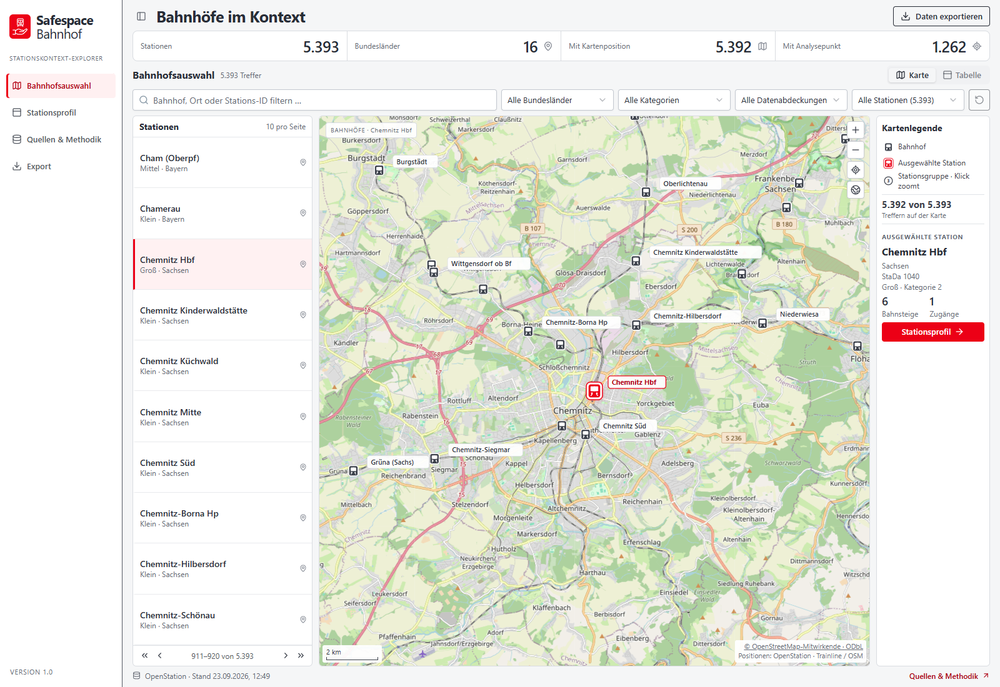
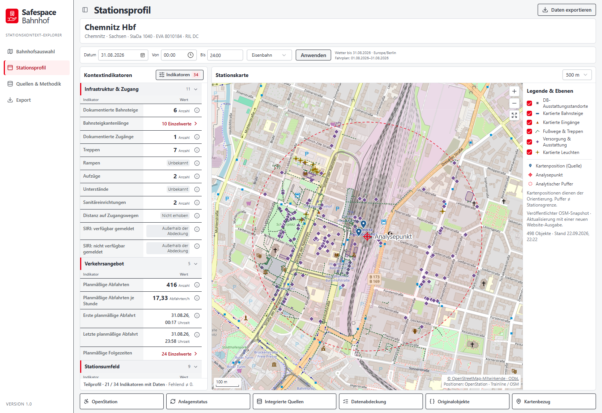
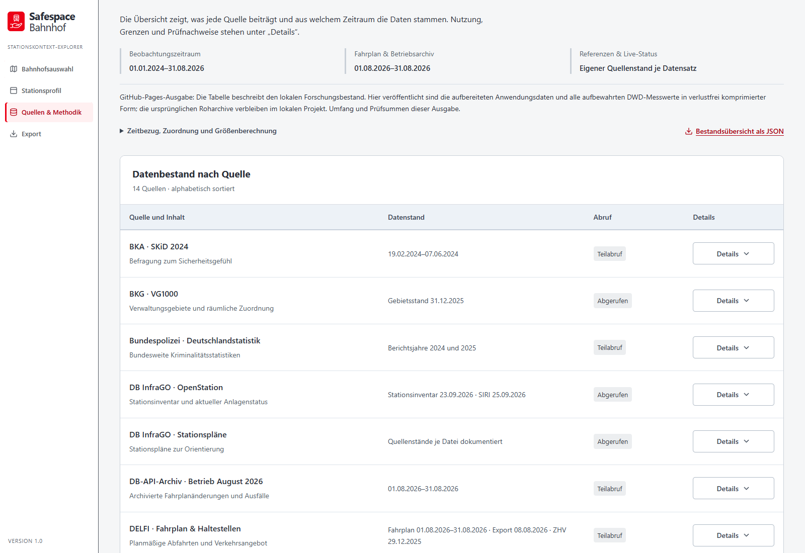
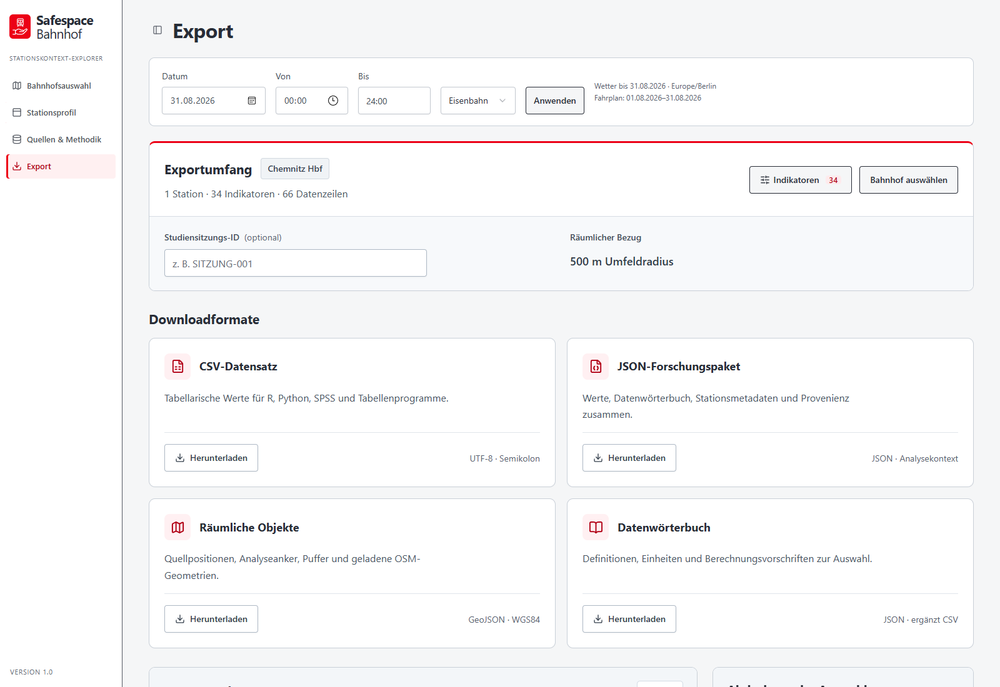

# Safespace Bahnhof

**Safespace Bahnhof – Stationskontext-Explorer** is a German-language website for exploring railway stations and their surroundings. It brings together infrastructure, transport, weather and geographic information for **5,393 DB InfraGO stations across all 16 German states**.

The website helps users inspect individual stations, understand the available evidence and download data for further analysis. It describes station context; it does not calculate safety scores or rank stations by risk.

## Appearance and features

The interface uses white panels on a light grey background, red accents for selections and actions, and a sidebar connecting four main views. Maps, compact indicator tables and expandable source details keep the selected station and its evidence together. The screenshots below show the included website edition with **Chemnitz Hbf** selected.

### Station explorer

Search by station name, place or identifier, and filter by federal state, station size or data coverage. Switch between an interactive map and a table, select a station, and open its profile. The map includes station labels, clusters, a legend and a summary of the selection. A fresh visit starts at Chemnitz Hbf.

### Station profile

Inspect platforms, entrances, equipment and accessibility details alongside timetable, weather and surrounding-area information where available. The profile offers **34 selectable context indicators**, date and time controls, transport-mode selection, and analysis radii of **250, 500 or 1,000 metres**. Map layers distinguish source objects, display positions and the analysis reference point. Detail panels expose individual values, original records and data coverage.

### Sources and methodology

Review what each source contributes, its reference period, retrieval status and coverage. Expand source details, browse additional research datasets, and read indicator definitions and calculation methods. Source dates remain separate from the selected analysis date.

### Data export

Preview the selected station's data and download **CSV**, a **JSON research package**, or **GeoJSON spatial objects**. A separate data dictionary explains the indicators, units and methods. Exports retain the selected analysis context and source information.

## Data processed

The website combines the following retained datasets. Dates below describe the included data, rather than a continuously updated feed.

| Source | Processed information and coverage |
| --- | --- |
| **DB InfraGO OpenStation** | Station identities, platforms, equipment, accessibility and assistance information for **5,393 stations**. The station inventory is dated **23 September 2026**. |
| **Trainline EU and OpenStreetMap** | Published positions matched to **5,392 stations**, plus nationwide OSM surroundings dated **22 September 2026**. Surroundings were processed at three radii around **1,262 verified equipment reference points**. |
| **BKG administrative geography** | Five nationwide boundary layers, including federal states and districts, with reference date **31 December 2025**. |
| **DELFI timetable and stop data** | Scheduled departures for **1–31 August 2026**, matched to **5,333 stations**, and a stop directory dated **29 December 2025**. |
| **DWD weather observations** | Hourly measurements from **15 product families**, including temperature, precipitation, humidity and wind, retained for **1 January 2024–31 August 2026**. Weather comes from regional monitoring stations. |
| **Zensus 2022** | **50 census grid datasets** covering population, households, buildings and housing, with reference date **15 May 2022**. Spatial context uses the verified equipment reference points. |
| **Operations, equipment status and station plans** | About **14.5 million archived train-stop records** from **August 2026**, matched to **5,215 stations**; a separate **25 September 2026 SIRI equipment-status snapshot**; **107 official station-plan PDFs**; and nationwide WDR lift/escalator disruption series for **October 2025–March 2026**. |
| **National research statistics** | Published Federal Police totals for **2024 and 2025**, and national **SKiD 2024** safety-perception results. These describe national context rather than individual stations. |

Source records were matched using documented identifiers, prepared for station profiles and maps, and filtered to their stated observation periods. Geographic context was calculated only where a verified analysis reference point was available. Source dates, original values, quality flags and provenance are retained so users can trace the displayed information. The website’s **Quellen & Methodik → Datenquellen** view provides the detailed dataset breakdown.

Coverage varies by station and indicator. Missing or protected values remain unknown, rather than becoming zero. A map position is not an analysis reference point, and an analysis buffer is not a station boundary. Later reference snapshots and equipment-status snapshots do not reconstruct historical conditions. National statistics, residential population and scheduled departures are not measurements of an individual station's safety or passenger presence. No project field observations, participant records or street-view imagery were included.
